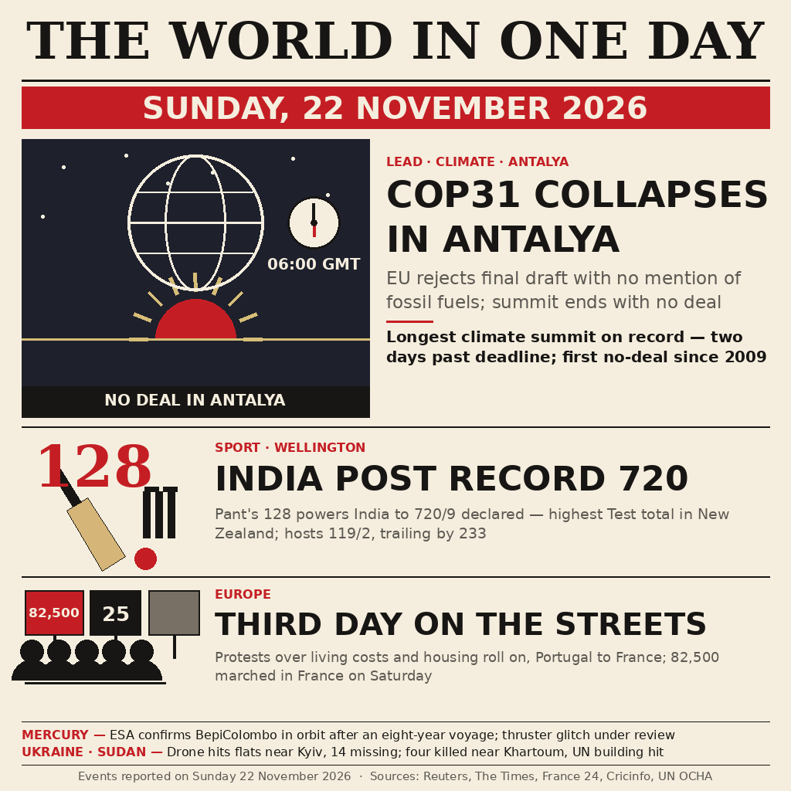

# makefun-news-image-20261122

[](https://make.fun/bounty/news-image-20261122)
[](https://make.fun/bounty/news-image-20261122)
[](https://make.fun/bounty/news-image-20261122)

Entry for the make.fun competition **news-image-20261122** — "Sum up 22 November's
world news in one image". The program draws one front page, *The World in One Day*,
for **Sunday, 22 November 2026**.

Resubmit v2 (23 Nov 2026): the Sunday story moved on after v1 was filed — COP31
collapsed with no deal, India declared on a record 720, the protests entered
their third day, and three briefs join the page. All stories verified against
reporting dated Sunday 22 November 2026.



## The day's stories

1. **LEAD · CLIMATE · ANTALYA — "COP31 COLLAPSES IN ANTALYA"**
   The COP31 climate summit in Antalya ends with no deal: the EU and the UK
   reject a final draft that makes no mention of fossil fuels, and the
   presidency concedes there is no consensus. The longest climate summit on
   record — two days past its deadline, the first COP to end with no deal
   since Copenhagen in 2009. *(The Times / Turkish Minute / CarrZee, 22 Nov 2026)*
2. **SPORT · WELLINGTON — "INDIA POST RECORD 720"**
   Rishabh Pant's 128 powers India to 720/9 declared — the highest Test total
   ever made in New Zealand — a lead of 352. New Zealand close day four on
   119/2, Devon Conway unbeaten on 59, still trailing by 233.
   *(Cricbuzz / Cricinfo, 22 Nov 2026)*
3. **EUROPE — "THIRD DAY ON THE STREETS"**
   Protests over living costs and housing roll into a third consecutive day,
   from Portugal to France; France's demonstrations run for a sixth weekend
   in a row, with 82,500 marching nationwide on Saturday, 21,500 in Paris.
   *(France 24 / Edge News, 22 Nov 2026)*
4. **ALSO TODAY**
   - **MERCURY** — ESA confirms BepiColombo in orbit after an eight-year
     voyage; a thruster glitch is under review, the spacecraft safe.
     *(Reuters / ESA, 22 Nov 2026)*
   - **UKRAINE** — A Russian drone hits a five-storey apartment block in
     Dymer, near Kyiv; 14 people missing. *(Reuters / France 24, 22 Nov 2026)*
   - **SUDAN** — Drones kill four near Khartoum and damage a UN building
     with staff inside. *(UN OCHA / Al Jazeera, 22 Nov 2026)*

## How to run

```sh
python3 draw_entry.py   # renders entry.png (1024x1024, deterministic)
python3 main.py         # copies entry.png to /output/entry.png
```

`main.py` is standard library only and does no network access. `draw_entry.py`
draws the image with Pillow and DejaVu fonts; running it twice produces the
same bytes.
